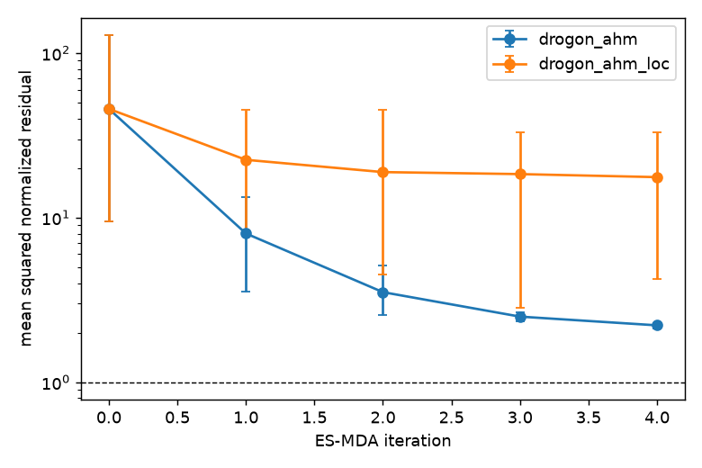
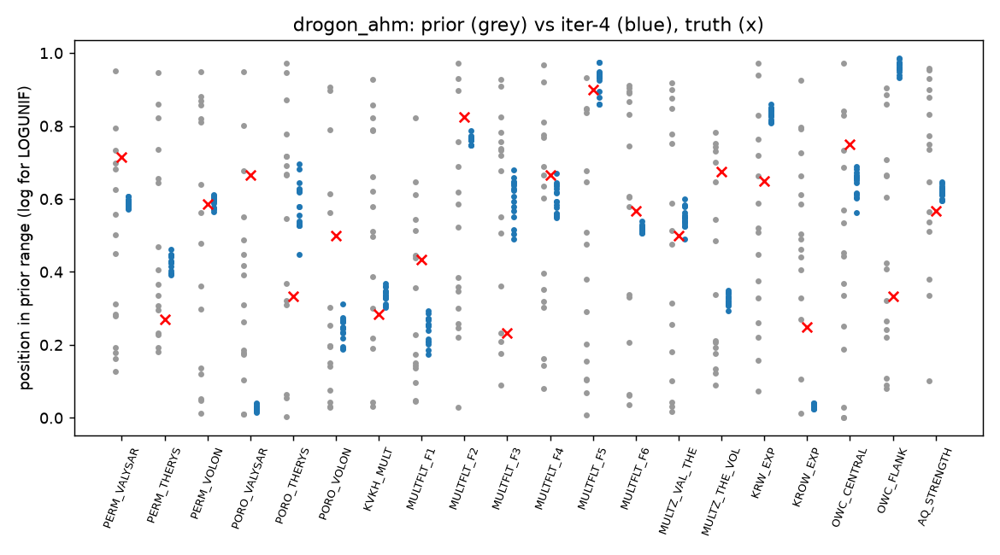
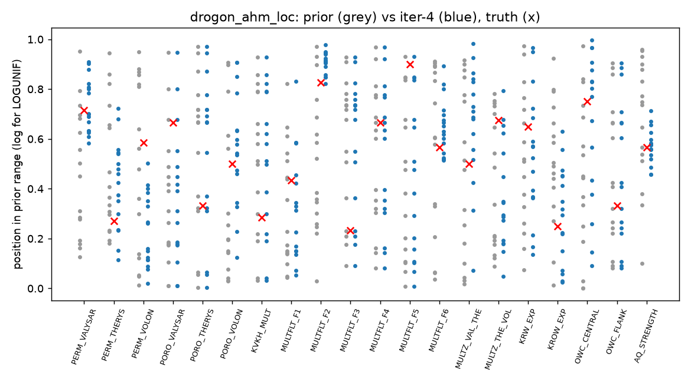
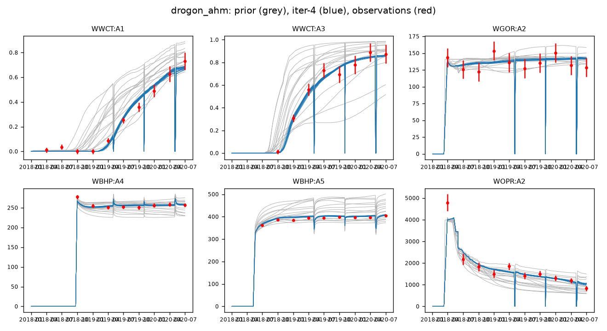
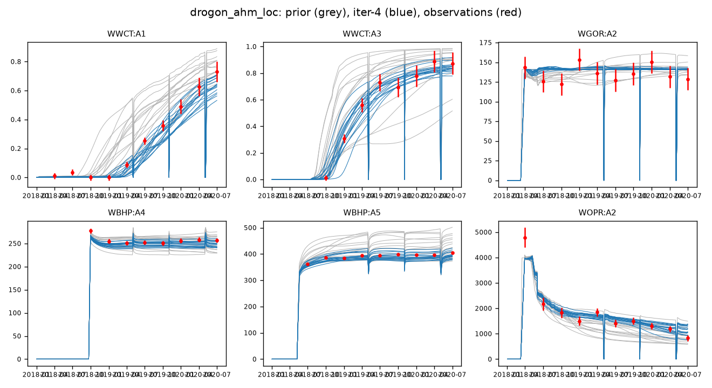
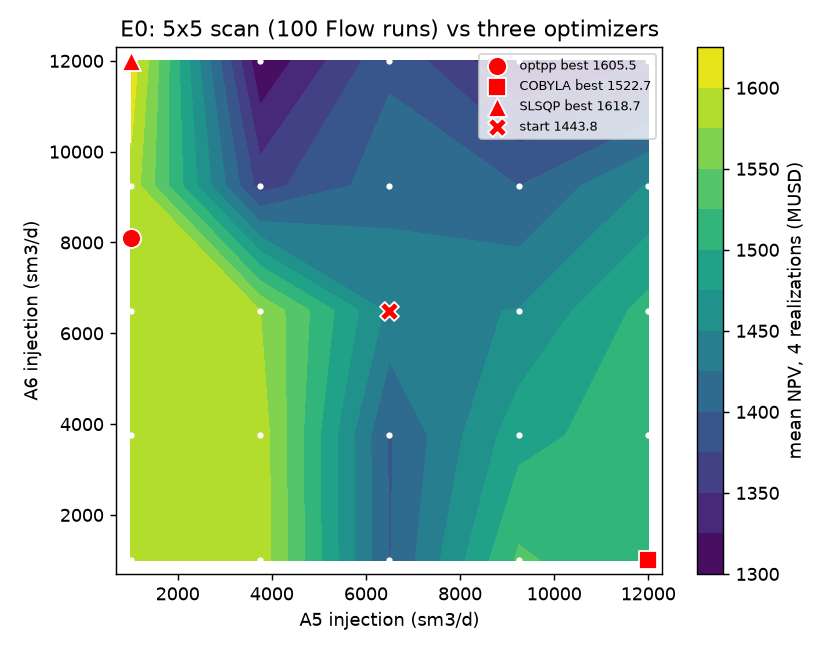
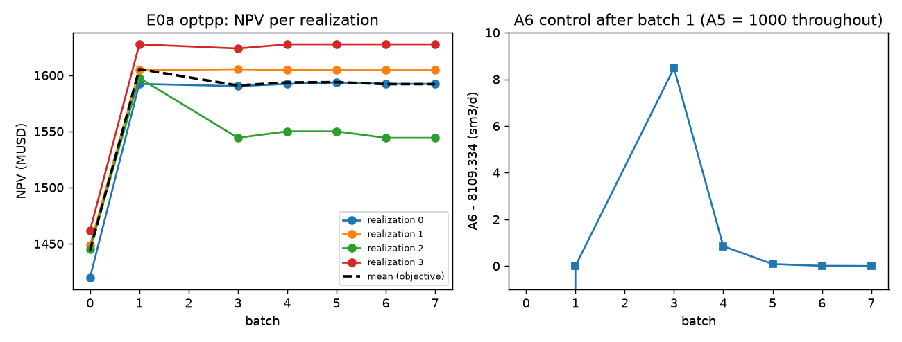
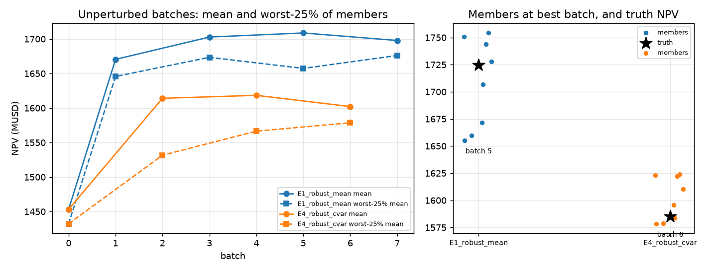
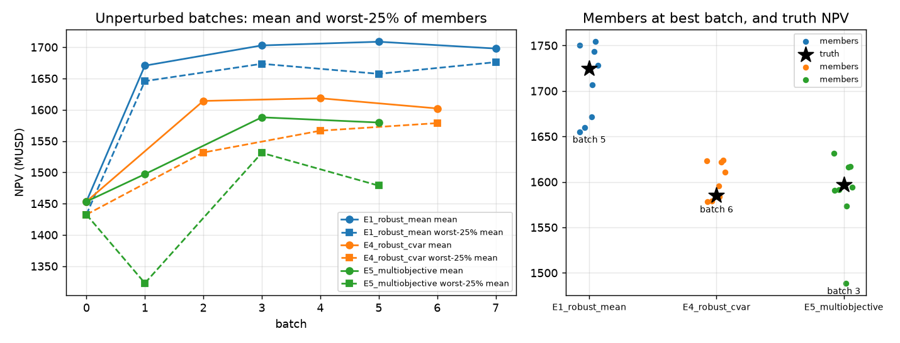
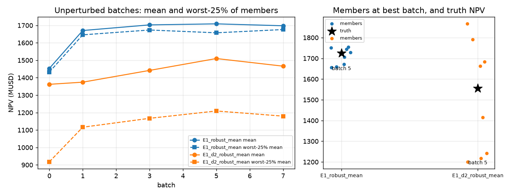

# Drogon end to end: FMU prior, ES-MDA history match, Everest stress suite

Public Drogon deck (OPM/opm-tests, ODbL), ERT/Everest 23.0.1, ropt 0.27.1, OPM Flow 2026.04, one 8-CPU box with
MAX_RUNNING 3. Run 2026-10-15 20:53 to 2026-10-16 (Oslo time). Every number gives its source file and its limiter.
The evidence trail is `/workspace/reports/drogon-program/` on the box: `decisions.tsv`, `commands.log`, `gaps.md`,
`STATUS.md`, and the QC folders. It is not in git. This report and its figures are.

## Summary

- **History match (N = 16, 20 parameters).** ES-MDA without localization (D1) cut the misfit from 45.8 to 2.22,
  with 0.88 for the truth run, but collapsed: 14 of 20 parameters have the truth more than 3 sd away. With adaptive
  localization (D2), the truth stays within 3 marginal sd, but the misfit is 17.6. Neither is fit for a decision. Rerun with N = 64-100
  (section 3).
- **Algorithms (2 controls, known answer).** SLSQP found the scan optimum in 16 simulations. optpp got close
  (36 simulations). COBYLA went to the wrong ridge and simulated controls outside the bounds (section 4.1).
- **Objective noise.** A 53 MUSD jump for an A6 change below 0.01 sm3/d comes from a well that Flow shuts, not from
  solver noise (section 4.3).
- **Robust control (12 controls, 8 members).** The mean objective gave +255 MUSD on the posterior and +307 on the
  truth. With the same batch budget, CVaR(0.25) gave a lower tail *and* a lower truth NPV than the mean optimum (sections 4.4-4.5).
  Both plans break the VRR ≥ 0.9 constraint on the truth.
- **Constraints.** With VRR ≥ 0.9 and a field water limit, optpp found no feasible improvement over the start in 8
  batches (section 4.6).
- **Drill order.** OP8, OP7, OP5, OP6 instead of OP5-OP8: +62.5 MUSD on the posterior and +37.6 on the truth (section 4.7).
- **Multi-objective.** NPV + oil recovery (0.75/0.25) found no tradeoff. E1's NPV-only plan is better on both
  objectives on the truth (section 4.8).
- **Posterior sensitivity.** The same optimization on the D2 posterior gives a different plan (A6 at its minimum instead of its maximum).
  On the truth, that plan is 169 MUSD worse (1555.3 against 1724.7). Which posterior you use decides the plan (section 4.9).
- **Skills.** 22 gaps found by running the skills on the case (G8 is a box quirk); fixes in 8 PRs (#14-#21), all green on Linux and Windows, none merged
  (section 5). The site translation pack has 5 templates with site-contract placeholders (section 6).

## Runtimes

| Run | What | Wall time | Simulations | Source |
|---|---|---|---|---|
| AHM D1 | ES-MDA 4 iterations, 16 members | 6537 s | 80 (5 ensembles x 16) | `commands.log` |
| AHM D2 | the same with adaptive localization | 4509 s | 80 | `commands.log` |
| E6 | failure handling, min_realizations_success | 386 s | 15 dispatched, 12 rows | `commands.log`, CSV |
| E0a / E0b / E0c | optpp / COBYLA / SLSQP, 2 controls | 1757 / 2440 / 407 s | 36 / 44 / 16 | same |
| E0_scan | 5 x 5 grid x 4 members | 2839 s | 100 | same |
| E1 | robust mean, 12 controls | 2303 s | 72 | same |
| E4 | robust CVaR(0.25) | 1534 s | 40 | same |
| E2 | E1 + linear and output constraints | 3789 s | 128 | same |
| E3 | drill order, 4 wells | 2415 s | 80 | same |
| E5 | weighted NPV + FOPT | 1824 s | 56 | same |
| E1_d2 | E1 on the D2 posterior | 2371 s | 72 | same |
| Truth checks | one Flow run per evaluated plan | 39-76 s each (18 runs, 1027 s) | | `commands.log` |

The times exclude a box restart at about 07:40 that broke the first relaunch (section 5, G17/G18) and the reruns after it.
## 1. The case and why

**Deck.** Drogon from OPM/opm-tests at commit `81215aa051dea6b3a5406096cd673543ceef8e6c` (ODbL, public). Fetched with
`tools/fetch_drogon.sh` (sparse checkout at the pin).

| Item | Value | Evidence |
|---|---|---|
| Grid | 46 x 73 x 31 = 104,098 cells, 70,972 active | Flow PRT of the base run |
| Physics | three-phase black oil, DISGAS + VAPOIL | deck RUNSPEC |
| Structure | faults F1-F6; zones Valysar / Therys / Volon (MULTNUM 1-3); 7 EQUIL regions | deck GRID/REGIONS |
| Wells | producers A1-A4 (WCONHIST RESV), injectors A5/A6, RFT pilots R_A2-R_A6 (WRFTPLT) | deck SCHEDULE includes |
| History | 2018-01-01 to 2020-07-01, 82 report steps | HIST deck |
| Prediction | restart at step 82 to 2025-01-01, adds OP5 (multi-segment, valves) and optional OP6-OP8 | PRED deck, everest/jobs/drogon_pred.py |

**Why this case.** It is the public analogue closest to a production FMU model: the same structure and keyword families
(MULTREGT, MULTFLT, multiple EQUIL regions, aquifer, RFT and multi-segment wells), and a run time (about 2.5 min per
history run on one thread, about 1.5 min per prediction) that allows a 16-member ES-MDA with 4 iterations and a
eleven-experiment Everest suite on one 15 GB box. The full deck is the "medium-to-complex" case asked for: big enough to
show the failure modes (tail realizations, shut-well observations, spread loss with N < parameters), small enough to
finish overnight.

**Limiter.** It is synthetic. The "truth" is one parameter draw inside the prior (`ert/truth.txt`) and the observations
are that truth run plus seeded noise (`tools/make_obs.py`, seed 20261015). So the prior contains the answer by
construction, which real fields do not guarantee, and model error is zero. The AHM results show what the workflow and
the skills can do, not how well Drogon can be history matched.
## 2. FMU setup and what the QC skills found

**Parameterization** (`ert/drogon.dist`, 20 GEN_KW parameters, applied by `jobs/drogon_params.py` as ERT include files):

| Family | Parameters | Prior | Deck mechanism |
|---|---|---|---|
| Zone permeability | PERM_VAL, PERM_THE, PERM_VOL | LOGUNIF 0.33-3 | MULTIPLY PERMX/PERMY per MULTNUM |
| Zone porosity | PORO_VAL, PORO_THE, PORO_VOL | UNIFORM 0.85-1.15 | MULTIPLY PORO per MULTNUM |
| Vertical anisotropy | KVKH_MULT | LOGUNIF 0.2-5 | PERMZ multiplier |
| Faults | MULTFLT_F1..F6 | LOGUNIF 0.001-1 | MULTFLT |
| Zone barriers | MULTZ_VAL_THE, MULTZ_THE_VOL | LOGUNIF 1e-4-1 | MULTREGT 1-2, 2-3 |
| Relative permeability | KRW_EXP, KROW_EXP | UNIFORM 0.6-1.6 | power transform of SWOF krw/krow |
| Contacts | OWC_CENTRAL, OWC_FLANK | UNIFORM -12..+12 m | EQUIL OWC shift (flank = regions 1, 4, 7) |
| Aquifer | AQ_STRENGTH | LOGUNIF 0.01-10 | AQUFETP volume 2e9 x s, PI 300 x s, AQUANCON on K=31 |

**Observations** (`ert/obs/`): 160 summary points (WOPR, WWCT, WGOR, WBHP for A1-A4 quarterly; WBHP for A5/A6) and 20
RFT points (4 depths in the last survey of each R well, GEN_DATA). Errors: WOPR max(10%, 20 sm3/d), WWCT max(10%,
0.02), WGOR max(10%, 5), WBHP 5 bar, RFT 2 bar.

**Design.** 16 realizations for 20 parameters on purpose (the "few realizations" ask). `prior_qc` flags N < parameters,
which is the right warning; design D2 adds adaptive localization as the guard against spurious spread loss.

**Runtimes** (`commands.log`, one thread, no MPI):

| Run | Wall time |
|---|---|
| History, base model | 147 s |
| History, truth (2 threads) | 124 s |
| Prediction from restart | 89-99 s |
| `ert test_run` (1 realization, full forward model) | 124 s |
| Everest smoke (1 realization, 1 batch) | 85 s |
| ES-MDA iteration, 16 realizations, MAX_RUNNING 3 | about 17 min; 25 min when one realization ran 24 min (iter-1 realization 15) |

Flow uses about 660-690 MB per run. The box had 2.4-6 GB free (other agents' browsers), so MAX_RUNNING is 3.

**QC findings.** Each gap was found by running the skill on the full deck and checking its output against the deck or a
plot. See `gaps.md` for the evidence files.

| Id | Skill | What happened | Outcome |
|---|---|---|---|
| G1 | schedule_qc | Exit 0 with no findings: the whole SCHEDULE is in an INCLUDE, so nothing was checked (false pass) | fixed in PR #14; mutation test (COMPDAT J=99 in the include) caught on the branch, missed on main |
| G2 | schedule_qc | Hundreds of W005 "DIMENS unavailable" lines | fixed in PR #14 (`--dimens`, one summary line) |
| G3 | obs_qc | GEN_DATA grouped per key: 5 RFT warnings instead of one group | fixed in PR #14 |
| G4 | flow_log_diagnose | Clean run reported "errors: 2" | fixed in PR #14 |
| G9 | obs_qc | 20 of 200 observations were taken on wells that were not flowing; obs_qc did not flag them, a plot did | new check in PR #14 (flags the 20: A3 8, A4 8, A5 1, A6 3); observations regenerated and AHM relaunched |
| G5 | everest_lint | False ERROR for list `initial_guess` on indexed controls | fixed in PR #15 |
| G6 | everest_cost | Crash on COBYLA (no perturbation_num) | fixed in PR #15; COBYLA cost now 56 simulations for E0b |
| G7 | everest_lint | Perturbation warning on drill-priority controls | doc note in PR #15 |
| G8 | (box) | Everest calls an install_data file "a mount point" on the overlay filesystem | box quirk, worked around by copying |
| G10 | update_log_report | RFT groups lose the well name (RFT_R_A) | fixed in PR #17 |
## 3. History match (ES-MDA, two designs)

### 3.1 Design D1: ES-MDA, 4 iterations, no localization

`ert es_mda --weights 15,7.5,3.75,1.875` (sum of 1/w = 1). 16 realizations, MAX_RUNNING 3, 80 Flow runs. Wall time
6537 s (1 h 49 min, `commands.log`). One realization (iter-1, realization 15) took 24 min against about 2.3 min for
the others and set the length of that iteration.

| Iteration | Mean misfit | Min-max | WOPR | WWCT | WGOR | WBHP | RFT |
|---|---|---|---|---|---|---|---|
| 0 (prior) | 45.8 | 9.46-129 | 9.17 | 27.2 | 63.7 | 85.2 | 10.4 |
| 1 | 8.01 | 3.53-13.4 | 5.38 | 7.42 | 5.86 | 12.6 | 5.75 |
| 2 | 3.52 | 2.55-5.09 | 1.87 | 3.62 | 1.38 | 6.00 | 3.73 |
| 3 | 2.50 | 2.34-2.66 | 1.52 | 2.47 | 1.09 | 3.91 | 3.22 |
| 4 (posterior) | 2.22 | 2.12-2.28 | 1.38 | 1.75 | 1.03 | 3.63 | 3.01 |
| truth run | 0.88 | | 1.06 | 0.61 | 0.84 | 0.82 | 1.26 |

Misfit = mean of squared normalized residuals over 180 observations (`tools/ahm_figures.py`; the fixed
`misfit_report.py` in PR #17 gives the same 45.8 and 2.22). Truth run: same observations against the noise-free
truth: 0.88 is the noise-consistent reference (with the assumed errors), not a hard floor.

**What it means.** The data misfit fell by a factor of 20, but the posterior sits 2.5 times above the truth reference,
and the 16 members span only 2.12-2.28. `misfit_report` CHI2: 2.22 is above the noise band 0.68-1.32. The members
agree with each other much more than they agree with the data.

**Parameters** (`qc2-D1/param_table.txt`, log10 for log-uniform parameters):
- 18 of 20 parameters have a posterior sd below 0.2 of the prior sd. Sampling noise alone at N = 16 gives ratios
  down to about 0.6.
- The truth is more than 3 posterior sd from the posterior mean for 14 of 20 parameters.
- The biggest misses compensate each other:
  - OWC_FLANK: 11.1 ± 0.35 against a truth of -4
  - PORO_VALYSAR: 0.858 ± 0.002 against 1.05
  - KROW_EXP: 0.633 ± 0.005 against 0.85
  - KRW_EXP: 1.43 against 1.25
  - Hypothesis, not tested by sensitivity runs: a deeper flank contact with less pore volume and different relative
    permeability reproduces the same water arrival.
- `prior_qc --posterior-runpaths` flags 4 parameters at a prior bound: PORO_VALYSAR, MULTFLT_F5, KROW_EXP and
  OWC_FLANK. On a real field, that finding would prompt a check of the prior bounds, identifiability and model error.
The bounds should not be widened automatically. Here the truth is inside them, so it
  is a symptom of the collapse, not of a narrow prior.

**Update logs** (`update_log_report.py`): the median response sd / observation error fell from 0.655 to 0.279, 0.202 and
0.157, and the number of observations below 0.1 went from 27 to 40, 54 and 70. In the last two updates ERT
deactivated 3 and 4 observations. In the last update: two WBHP_A3 and WGOR_A4_20181001 by std_cutoff, and
WBHP_A1_20200701 as an outlier (`qc2-D1/update_log.txt`).

**The mean hides adverse points.** In the D1 posterior, 22 of 180 observations are out of reach of every member and
8 got clearly worse than in the prior. In D2, 16 of each (`qc2-D*/misfit_branch.txt`).

**Limiter.** N = 16 for 20 parameters is rank deficient by design. The collapse is what the skills predicted
(`prior_qc` before the run, the `misfit_report` gate after). The truth comparison is possible only because the case
is synthetic.
### 3.2 Design D2: the same ES-MDA with adaptive localization

`ANALYSIS_SET_VAR STD_ENKF LOCALIZATION True`, otherwise as D1. Wall time 4509 s (1 h 15 min), 0 of 80 runs failed (prior and 4 updates x 16).

| Quantity (16 realizations) | Prior | D1 posterior | D2 posterior | Truth run |
|---|---|---|---|---|
| Mean misfit (min-max) | 45.8 (9.46-129) | 2.22 (2.12-2.28) | 17.6 (4.24-32.8) | 0.88 |
| WBHP family | 85.2 | 3.63 | 52.3 | 0.82 |
| RFT family | 10.4 | 3.01 | 3.12 | 1.26 |
| Parameters with sd ratio < 0.2 (log10 for log-uniform) | | 18 of 20 | 1 of 20 (MULTFLT_F2; on native scale AQ_STRENGTH instead) | |
| Truth more than 3 posterior sd away | | 14 of 20 | 0 of 20 (max abs z 2.5) | |
| Parameters at a prior bound | | 4 | 1 | |

Sources: `qc2-D*/misfit_branch.txt`, `qc2-D*/param_table.txt`, `qc2-D*/prior_post.txt`.

**Why D2 barely moves.** Adaptive localization keeps a parameter-response pair only when the ensemble correlation
is above about 3/sqrt(N). At N = 16 that threshold is 0.75. After iter-1:
- 12 of 20 parameters still had sd ratio ≥ 0.96 (D1: 0.22-0.80);
- 7 of 20 parameters keep the prior sd exactly at iter-4.

The update-log median response sd / error rises from 0.655 to 0.825 over the four steps, against 0.157 in D1. For every
parameter, D2 keeps the truth within 3 marginal posterior sd (max |z| 2.5; joint coverage was not tested), but WBHP stays unmatched.

### 3.3 Decision

See `decision_memo_ahm.md`. Neither design is fit for a business decision at N = 16:
- **D1** is confident and wrong.
- **D2** is honest and unconverged.

The most likely common cause is N = 16 against 20 parameters. Two designs at the same N do not isolate it
from identifiability, nonlinearity or the localization settings. The memo recommends N = 64-100 with localization, or fewer
parameters: the six fault multipliers carry little signal.

For Everest, the rule fixed before the AHM (use D2 unless its misfit is more than 1.5 times D1's) picked **D1**. Every
robust Everest number below therefore comes from an overconfident 16-member posterior. Section 4.9 repeats the
robust-mean optimization on D2 to measure how much that matters.
## 4. Everest on the D1 posterior

All experiments use the prediction from the history restart (step 82, 2020-07-01) to 2025-01-01:
- OP5 is a multi-segment well with valves;
- prices: oil 400 USD/sm3, gas 0.12 USD/sm3; produced water costs 30 and injected water 10;
- discount 8%; a new well costs 25 MUSD;
- VRR is integrated from FVIR/FVPR.

Configs are generated by `everest/make_configs.py`; Everest 23.0.1, ropt 0.27.1, MAX_RUNNING 3. Run times are from
`commands.log`; simulation counts are rows in `experiment_results.csv`.

### 4.1 Algorithm check against a brute-force scan (E0a-c, E0_scan)

Two controls (A5 and A6 injection rate, constant over the prediction, bounds 1000-12000 sm3/d, start 6500/6500) and
4 realizations. The scan evaluates a 5 x 5 grid on every realization.

| Run | Algorithm | Simulations | Wall time | Best mean NPV (MUSD) | At (A5, A6) | Notes |
|---|---|---|---|---|---|---|
| E0_scan | grid 5 x 5 | 100 | 2839 s | 1618.7 | (1000, 12000) | reference |
| E0c | scipy/SLSQP | 16 | 407 s | **1618.7** | (1000, 12000) | one step to the corner; stopped after 2 batches with both bounds active |
| E0a | optpp_q_newton | 36 | 1757 s | 1605.5 | (1000, 8109) | best at batch 1; batches 3-7 within 8.5 sm3/d of it (≤ 0.01 from batch 6) scored 1591-1594 (section 4.3) |
| E0b | scipy/COBYLA | 44 | 2440 s | 1522.7 | (11999, 1001) | went to the opposite ridge; trial points outside the bounds (A5 = 17500, A6 = 961) |
| start | | | | 1443.8 | (6500, 6500) | |

**Reading.**
- The landscape is not convex. The start point sits in a trough (1443.8). Low A5 with any A6 is a plateau at about
  1580-1619, and a second ridge lies at high A5 / low A6 (about 1500-1530).
- **SLSQP** found the scan optimum in 16 simulations. The prior experience on this pin, "SLSQP stalls", did not
  reproduce here. The difference is likely the gradient: SLSQP got a usable finite difference at the start and
  jumped to a vertex where both bounds are active. Treat the stall as config dependent, not certain. The
  `everest_diagnostics` stall check still applies.
- **optpp** reached the plateau and then wandered along the discontinuity.
- **COBYLA** used the most simulations, ended on the worse ridge, and ran the simulator outside the control bounds
  (G19). For a real field, that can mean rates above facility limits.

**Limiters.** The scan has a 2750 sm3/d step, so the true optimum may lie between grid points. There are 4
realizations and one start point, so the ranking of the algorithms is one sample of each, not a benchmark.

**Field-practice relevance.**
- Run a two-control known-answer check (template 05) before a large Everest job.
- On this problem, the cheapest gradient method was also the best.
- When bounds stand for facility limits, do not use a method that evaluates outside them (as scipy/COBYLA did here).

**Check against the truth** (synthetic case only; `tools/truth_eval.py`, one Flow run each on the truth model):

| Controls | Posterior mean NPV (4 members) | Truth NPV | Truth gain over start |
|---|---|---|---|
| start (6500, 6500) | 1443.8 | 1418.1 | |
| SLSQP (1000, 12000) | 1618.7 | 1622.9 | +204.8 |
| optpp (1000, 8109) | 1605.5 | 1613.7 | +195.6 |
| COBYLA (11999, 1001) | 1522.7 | 1470.1 | +52.0 |

The ranking holds on the truth. Here the overconfident D1 posterior still pointed to the right corner, but it
overstated the COBYLA point by 53 MUSD.
### 4.2 Failure handling (E6, `min_realizations_success: 4`)

Realizations [0, 1, 2, 3, 99]. Realization 99 is an empty posterior folder, so its prepare step fails with "expected
one restart ... found 0".
- ERT resubmits each failed realization once ("attempt 2 of 2"), so the failure uses a queue slot twice.
- The run continued on 4 members. The batch-0 objective, 1443.80 MUSD, equals the mean of the 4 members (1419.68,
  1448.58, 1445.22, 1461.73): the weights were renormalized.
- Batch 1 moved to A5 = 1000 (lower bound) and A6 = 8109 sm3/d, NPV 1605.5 (+11%).
- Wall time 386 s for 2 batches.
- `experiment_results.csv` has no row for the failed member. A diagnostic that counts failed rows sees 0. Only the
  log ("Simulation 4 failed") or a check of the config realizations against the rows (PR #18) shows the failure.

**Field-practice relevance:** here, on the local queue, one broken realization cost two submissions per batch.
We expect the same on LSF, but did not test it. The failure is invisible in the result table.

### 4.3 Objective discontinuity (E0a)

optpp_q_newton on 2 controls, 4 realizations, 8 batches, perturbation 500 sm3/d: 1757 s.
- The best result is batch 1 (1605.5). Batches 3-7 converge to batch 1's controls (A6 within 8.5 sm3/d, then within 0.01 at
  batches 6-7) but score 1591-1594.
- Realization 2 alone drops from 1597.6 to 1544.3 MUSD for an A6 change of 0.001 sm3/d. The deck rounds this to
  8109.33 against 8109.34.

Flow 2026.04 reproduced its result on this deck: two reruns gave identical FOPT (13,016,579 sm3), in 72 s and 73 s
(`runs/noise`). The two decks take different solver paths at the first predicted step (2020-07-01):
- In one, a convergence failure and timestep chop happen and OP5 survives.
- In the other, Flow logs "Well OP5 will be shut as it can not operate under current reservoir conditions". The well
  is shut until the next schedule reissue and produces 362,000 sm3 less oil.

The objective is therefore piecewise. A finite difference that spans the well-status switch is not a valid local derivative.
`flow_log_diagnose` did not report the shut (G16, fixed in PR #19).

**Field-practice relevance:** before you trust an Everest gradient, grep the PRT of every batch for "will be shut as it can
not operate". A well that the simulator closes makes NPV discontinuous in the controls.
### 4.4 Robust well control, mean objective (E1)

12 controls:
- A5 and A6 injection rates in 4 periods (2020-07, 2021-07, 2022-07, 2023-07), bounds 1000-12000 sm3/d;
- A1, A2, A4 and OP5 liquid rates, bounds 500-6000 sm3/d.

The run used 8 D1 realizations, optpp_q_newton with 1 perturbation per realization, and 8 batches: 72 simulations
in 2303 s (`commands.log`).

| | Initial (batch 0) | Best (batch 5) | Source |
|---|---|---|---|
| Mean NPV, 8 members (MUSD) | 1453.3 | 1708.7 (+255.4, +17.6%) | `qc3/diag_E1.md`, `tools/exp_stats.py` |
| Member min - max | 1419.7 - 1483.6 | 1655.2 - 1754.2 | same |
| Worst-25% mean (2 of 8) | 1432.5 | 1657.4 | same |
| **Truth NPV at these controls** | 1418.1 | **1724.7 (+306.6)** | `runs/truth_eval/results.csv` |

Controls at batch 5, the best observed batch by mean (`qc3/diag_E1.md`):
- A5 3188, 9941, 4133 and 1000 (at the bound) in periods 1-4;
- A6 at the 12000 maximum in period 1;
- OP5 at its 6000 maximum;
- A4 cut to 1953.

Three controls are at a bound. At batch 7, A5 is at 1000 in periods 1 and 4, so four are.

Batch 7 (1697.8) is below batch 5, and the diagnostics flag a non-monotone objective. That is consistent with the
discontinuity in 4.3, so batch 5 is the result by the objective (mean). By the worst-25% mean, batch 7 is better (1676.1 against 1657.4).
So "best" depends on the metric you select.

**Limiters.**
- 8 of 16 members from an overconfident posterior (section 3).
- The truth gain (+306.6) is above the posterior mean gain (+255.4) and close to the posterior best member; the
  posterior did not overstate the gain here. This is one truth, not a calibration.
- With 3 bounds active, the result is partly set by the bounds. An optimum was not proven; batch 5 is the best observed batch.
- E1 has no constraints. At these controls, the truth VRR is 0.72, below the 0.9 that E2 requires (`runs/truth_eval/results.csv`).
  The result is an unconstrained economic result, not a plan that is ready to execute.
### 4.5 Robust well control, CVaR objective (E4) against the mean (E1)

E4 has the same 12 controls, 8 members, optpp_q_newton, seed and 8-batch budget as E1. The objective is the
lower-tail CVaR at `percentile: 0.25`, which is the mean of the worst 2 of 8 members. Percentile is used because
`number_of_realizations` selected the best members in this ropt version (a known issue on this ropt pin from earlier work, given in the brief; not re-tested in this run). E4 took
1534 s for 40 simulations (`commands.log`, `scratch/everest/E4_robust_cvar/batch_*`).

| | E1 (mean), best batch 5 | E4 (CVaR 0.25), best batch 6 | Source |
|---|---|---|---|
| Mean NPV, 8 members (MUSD) | 1708.7 | 1602.1 | `qc3/diag_E1.md`, `qc3/diag_E4.md` |
| Worst-25% mean (CVaR 0.25) | **1657.4** | 1578.6 | same; E1 value from `tools/exp_stats.py` |
| Member min - max | 1655.2 - 1754.2 | 1578.5 - 1624.1 | `tools/exp_stats.py` |
| Truth NPV at these controls | **1724.7** | 1585.3 | `runs/truth_eval/results.csv` |
| Simulations / wall time | 72 / 2303 s | 40 / 1534 s | `commands.log` |

**Finding.** With the same batch budget, the mean-optimised controls beat the CVaR-optimised controls on the CVaR
metric too (1657.4 against 1578.6), and on the truth (+139 MUSD). E4 did not fail. It ran out of batches with the
CVaR still rising: 1432.5, 1531.7, 1566.5, 1578.6 over batches 0, 2, 4 and 6.

E1's first step (batch 1) already has a worst-25% mean of 1646, above E4's final 1578.6 (`tools/ev_figures.py`).

**Why (from the batch folders).** In the gradient batches, ropt simulated only the members in the tail: 2 of 8 in
batches 1, 3, 5 and 7. The tail set changed between batches ({0,2}, {2,6}, {1,2}, {1,2}). Each gradient therefore
rests on 2 one-perturbation samples, and the active members switch. A noisier gradient is our hypothesis
for the slower progress. Gradient variance was not measured. Per batch this is cheaper (40 against 72
simulations) but makes less progress. The control trajectory also differs: E4 cuts A5 to the 1000 bound in periods
2 and 3, where E1 raises A5 in period 2.

**Limiters.**
- One seed, one 8-batch budget, 8 members. The 25% tail is 2 members, so CVaR here is close to a min-of-2.
- The members come from the overconfident D1 posterior (section 3), so the tail is narrow (spread 46 MUSD at E4's best).
- At equal *simulations* rather than equal batches, the observed pattern would allow about 14 CVaR batches. This is an
  illustrative budget figure; that run was not made, and the actual schedule could differ.
- Do not conclude "CVaR is worse." Conclude that at this budget and ensemble size, CVaR(0.25) of 8 members gives a
  result that is no better than the mean, possibly because its gradient is noisier. On this case, the mean result already protects the tail. Truth VRR at
  E4's controls is 0.73, so this result is also unconstrained.
### 4.6 Linear and nonlinear constraints (E2)

E2 uses the E1 set-up (12 controls, 8 D1 members, optpp_q_newton, 8 batches) and adds:
- 4 linear input constraints: A5 + A6 ≤ 14000 sm3/d in each period;
- 2 output constraints on the member mean: field water rate max_fwpr ≤ 15000 sm3/d and VRR ≥ 0.9.

E2 took 3789 s for 128 simulations (`commands.log`, `experiment_results.csv`). With constraints, every batch evaluated the
function and the gradient (64 + 64 rows), against 72 for E1. The `everest_cost` upper bound (128) was exact here.

| Batch | Mean NPV (MUSD) | Mean VRR | Mean max FWPR | Feasible | Truth NPV |
|---|---|---|---|---|---|
| 0 (start) | 1453.3 | 0.916 | 11394 | yes | 1418.1 |
| 1 | 1505.5 | 0.797 | 11240 | no (VRR) | |
| 4 | 1578.3 | 0.771 | 10343 | no (VRR) | |
| 5 (best objective) | 1606.3 | 0.813 | 9708 | **no (VRR)** | 1567.3 (VRR 0.816) |
| 6 | 1385.2 | 1.034 | 8858 | yes | |
| 7 (last) | 1294.5 | 1.063 | 8488 | yes | 1419.5 (VRR 0.983) |

Sources: `qc3/diag_E2.md` (PR #21 script; the original output is `qc3/diag_E2_before_pr21.md`), `runs/truth_eval/results.csv` (truth runs `E2_constrained_*`).

**Finding.** The run found **no feasible improvement**. The start is the best feasible batch. optpp left the
feasible region in the first step. The start VRR (0.916) is close to the 0.9 limit, and the trajectory shows an
NPV/VRR tradeoff (injector and producer rates moved together, so we do not attribute it to injection alone). It traded NPV for VRR for 5 batches and returned to feasibility only in batches 6-7, below the start.
VRR was the only violated constraint. The water-rate limit was never approached. The period-2 injection limit became
active at batch 7 (A5 + A6 = 13999.99 against 14000).

**Skill gap G22.** `everest_diagnostics` reported "Best batch 5, improvement 153.0", and its own constraint table lists batch 5 as
VIOLATION. A reader who stops at the headline takes an infeasible plan. The fix (best *feasible* batch, with
"no feasible improvement" when that is the start) is PR #21; on the real E2 output the fixed
script says "No feasible improvement over the initial batch. Best batch overall 5 is INFEASIBLE".

**Truth check.** On the truth, batch 5 also violates VRR (0.816), so the posterior got the constraint right. At the final batch, the
truth NPV (1419.5) is 125 MUSD above the posterior mean (1294.5): the D1 posterior is pessimistic at that point.
This is one tested point, not a calibration.

**Limiters.**
- One start point next to the VRR limit. A start inside the feasible region (for example VRR 1.0) would test the method fairly.
- Constraints on the member mean: individual members can violate them.
- 8 batches. optpp's interior-point path might have improved with more batches; that run was not made.
- For a field case, start feasible with a margin, and check feasibility per batch, not only the objective.
### 4.7 Drill order (E3)

Four new producers OP5-OP8, each with a priority control in [0, 1]. The highest priority gets the first rig slot
(2020-07, 2021-01, 2021-07, 2022-01). Each well costs 25 MUSD, discounted to its slot. All four wells are always
drilled, so only the order changes. Injection and producer rates stay at the base values. The run used 8 D1 members,
optpp_q_newton with 2 perturbations of 0.25 per member, and 6 batches: 80 simulations in 2415 s (`commands.log`).

| Batch | Order (slot 1 → 4) | Mean NPV, 8 members (MUSD) | Member min - max | Truth NPV |
|---|---|---|---|---|
| 0 (start) | OP5, OP6, OP7, OP8 | 1425.4 | 1382.5 - 1494.3 | 1372.0 |
| 1 | OP5, OP8, OP7, OP6 | 1465.6 | 1431.0 - 1486.2 | |
| **3 (best)** | **OP8, OP7, OP5, OP6** | **1487.9 (+62.5)** | 1443.9 - 1578.3 | **1409.6 (+37.6)** |
| 5 | OP7, OP8, OP5, OP6 (tie OP7 = OP8 = 1.0) | 1477.6 | 1428.6 - 1520.2 | |

Sources: `experiment_results.csv` (unperturbed rows), `runs/truth_eval/results.csv`.

**Reading.**
- The optimizer moved OP6 to the last slot (priority 0 from batch 1) and brought OP7/OP8 forward. On the truth, this order gains
  37.6 MUSD, against the 62.5 the posterior predicted. The posterior overstated the gain by 25 MUSD.
- The objective is a step function of the priorities. 48 perturbation rows tried 12 different orders. Only perturbations that change the order
  give a non-zero difference. With a perturbation of 0.25 (a quarter of the range), 12 different orders appeared, so the
  perturbations did reach other orders. A small perturbation, as usually used for rates,
  changes the order only near a tie, so most of its differences would be zero (template 04 README).
- At batch 5, OP7 and OP8 are both at the upper bound 1.0. A tie decides the order. The case job breaks ties by
  insertion order; the template's `well_control.py` breaks them by well name. Either way, the optimizer cannot
  separate tied wells. A real run should check the best order against direct runs of its neighbours.
- At these rates, the truth max FWPR (17,400 sm3/d) is above the 15,000 limit in E2. A drill-order result must be
  rechecked with the rate controls and constraints together.

**Limiters.** 4 wells give 24 orders; Everest evaluated 12 of them in total (most only on a single perturbed member). A direct run of all 24
orders on the 8 members (192 runs, about 1.7 h here at 95 s per run and MAX_RUNNING 3) would give the true ranking; it was not made. One seed.
### 4.8 Multi-objective, weighted sum (E5)

E5 uses the E1 controls and members with two objectives: NPV (weight 0.75, scale 1500 MUSD) and cumulative oil
FOPT (weight 0.25, scale 6 MMsm3). Everest maximizes the weighted sum of the scaled objectives. optpp_q_newton, 6 batches: 56 simulations in 1824 s
(`commands.log`).

| | Batch | Mean NPV (MUSD) | Mean FOPT (MMsm3) | Weighted objective | Truth NPV | Truth FOPT |
|---|---|---|---|---|---|---|
| Start | 0 | 1453.3 | 5.617 | 0.961 | 1418.1 | 5.538 |
| E5 best | 3 | 1587.9 | 5.987 | 1.043 | 1597.2 | 6.018 |
| E5 last | 5 | 1579.6 | 5.989 | 1.039 | | |
| E1 (NPV only), for comparison | 3 / 5 | 1702.8 / 1708.7 | not recorded | | — / 1724.7 | — / 6.176 |

Sources: `qc3/diag_E5.md`, `qc3/diag_E1.md`, `runs/truth_eval/results.csv`. Everest's weighted value is the
negative `batch_total_objective_value` and matches 0.75·NPV/1500 + 0.25·FOPT/6 to 4 decimals.

**Finding.** E5 did not find a tradeoff. On the truth, E1's NPV-only plan has both the higher NPV (+127.6 MUSD) and the
higher oil recovery (+0.16 MMsm3) than E5's best plan. For these two plans, NPV and FOPT did not trade off. E5 also progressed more slowly: 1587.9 against E1's 1702.8 at
the same batch 3. With one weight pair and one trajectory, this does not show that there is no Pareto tradeoff.
E1 did not record FOPT as an objective, so the posterior E1 FOPT is not available. The comparison uses the truth.

**Limiters.**
- One weight pair. A real Pareto study needs several weights or an epsilon constraint, about 6 x 30 min here.
- 6 batches against E1's 8.
- Where the objectives agree, a weighted sum cannot show a front. Choose a second objective that competes with NPV (for
  example, water injected or late-life VRR) before you run a multi-objective study.
### 4.9 Posterior sensitivity: E1 repeated on the D2 posterior (E1_d2)

This is E1 unchanged (12 controls, mean objective, optpp, 8 batches, seed), except that the 8 members come from the
localized D2 posterior. 72 simulations in 2371 s (`commands.log`).

| | E1 on D1 | E1_d2 on D2 | Source |
|---|---|---|---|
| Members at start: mean (min - max) | 1453.3 (1419.7 - 1483.6) | 1362.1 (686.3 - 1907.0) | `tools/exp_stats.py` |
| Best batch: mean (min - max) | 1708.7 (1655.2 - 1754.2), batch 5 | 1509.8 (1200.8 - 1866.4), batch 5 | same |
| Posterior gain | +255.4 | +147.8 | |
| **Truth NPV at the best controls** | **1724.7 (+306.6)** | **1555.3 (+137.2)** | `runs/truth_eval/results.csv` |
| Truth VRR at those controls | 0.72 | 0.65 | same |
| A6 injection, periods 1-4 (sm3/d) | 12000, 5518, 6887, 4065 | 1000, 5871, 1000, 1000 | `qc3/diag_E1*.md` |

**Finding.** The posterior choice changes the plan, not only the number. D1 puts A6 at its maximum in period 1. D2
puts A6 at its minimum in 3 of 4 periods. On the truth, the D1 plan is better by 169 MUSD. This happens although D1 is
the overconfident posterior and D2 has all 20 parameters within 3 marginal sd of the truth (section 3; joint coverage not tested). Both posteriors predicted their own
plan's truth NPV within 46 MUSD (D1 16 low, D2 45 low).

**Why, as far as the evidence goes.** D2 is barely updated (misfit 17.6, 7 parameters at the prior sd). Its members
span 1221 MUSD at the start. The mean over 8 of them is a noisy target. Our hypothesis, not tested: the optimizer follows
members far from the truth. D1's members are wrong in their parameters, but they all reproduce the history (misfit 2.22). For these
controls, that seems to matter more than parameter coverage. This is one truth and one seed. It does not show that
an overconfident posterior is better in general.

**Consequence.** Neither posterior is a sound basis for a decision. Section 3 recommends N = 64-100 with localization. The
plan difference (169 MUSD on the truth, opposite A6 strategy) measures what is at stake.

**Limiters.** One seed, 8 members from each posterior, and one synthetic truth. The D1 plan was not run on the D2 members, nor the
D2 plan on the D1 members (16 runs, about 10 min). That cross-check would separate "a better plan" from "a different
posterior".
## 5. Skill bugs found and fixed

Each gap was found by running a skill on the full Drogon case and checking its output against the deck, a plot, an
independent calculation or the truth. Every fix has a behavior test with literal asserts. None is merged; the owner
merges.

| PR | Gaps | Skill | What was wrong on Drogon | Proof of fix |
|---|---|---|---|---|
| [#14](https://github.com/REinMX/reservoir-engineer-agent/pull/14) | G1-G4, G9 | deck-scal-pvt-qc, history-match-qc, flow-preflight | schedule QC silently passed a deck whose SCHEDULE is all INCLUDEs; W005 flood; RFT groups split per key; "errors: 2" on a clean run; 20 observations on wells that were not flowing | mutation (COMPDAT J=99 in an include) caught on the branch, missed on main; obs_qc flags the 20 shut-well points |
| [#15](https://github.com/REinMX/reservoir-engineer-agent/pull/15) | G5-G7, G11 | everest-config-author-lint | false ERRORs on list `initial_guess` and on constraint weights of indexed controls (E2: 4 false errors); cost estimator crashed on COBYLA | E2 lint: 4 errors on main, 0 on the branch; COBYLA cost 56 simulations |
| [#16](https://github.com/REinMX/reservoir-engineer-agent/pull/16) | pack, G17 | templates/site (stacked on #15) | template `prepare` failed on a resubmitted realization (the exact FileExistsError that broke the suite) | the new test fails on the old code with the same FileExistsError |
| [#17](https://github.com/REinMX/reservoir-engineer-agent/pull/17) | G10, G12-G14 | history-match-qc | `misfit_report` dropped all 16 members for ERT's `ECLBASE model/X-<IENS>` layout; ignored GENERAL_OBSERVATION (RFT, 11% of the data); counted LOG10_ companions (33 parameters instead of 20); update-log groups merged the RFT wells | D1 misfit 45.8 → 2.22 and RFT family 3.01 match `ahm_figures.py` exactly; on main the command fails |
| [#18](https://github.com/REinMX/reservoir-engineer-agent/pull/18) | G15, G18, G19 | everest-diagnostics | could not read Everest 23 `experiment_results.csv`; failed realizations invisible; `everest run` exit 0 after "Experiment failed"; COBYLA trial points outside the bounds not flagged | E6: realization 99 missing in both batches, 3 failed simulations; E0b: A5 = 17500 and A6 = 961 flagged |
| [#19](https://github.com/REinMX/reservoir-engineer-agent/pull/19) | G16 | flow-preflight | a simulator well shut ("can not operate") not reported; it made NPV jump 53 MUSD for an A6 change below 0.01 sm3/d | the OP5 shut at step 82 is listed on the real PRT; absent on the other |
| [#20](https://github.com/REinMX/reservoir-engineer-agent/pull/20) | G21 | everest-config-author-lint (stacked on #15) | `everest_cost` gave `max_batch_num*(perturbation_num+1)*N` as "the estimate"; the actual count was 31-79% of it on 6 runs (CVaR gradients simulate only tail members), exact on E2 | output says upper bound; `--observed` counts the rows of a previous run: E1 72, E4 40, E0b 44 on the real outputs |
| [#21](https://github.com/REinMX/reservoir-engineer-agent/pull/21) | G22 | everest-diagnostics (stacked on #18) | headline "Best batch 5, +153" on E2, where batch 5 violates VRR ≥ 0.9; no feasible batch beat the start | on the real E2 output: "No feasible improvement over the initial batch. Best batch overall 5 is INFEASIBLE" |

G8 (overlay-filesystem "mount point" quirk) is specific to the box. The case copies the deck to avoid it.

**Lesson from the box restart (G17/G18).** The suite has three layers that each assumed success:
- a forward model that is not idempotent;
- an ERT resubmit into the same runpath;
- a runner that wrote DONE from the exit code.

Eight experiments "finished" in three minutes with no results. The case now writes DONE only after
`verify_experiment.py` confirms a results table with at least `min_realizations_success` members per batch and no
"Experiment failed" in the log. The template carries the idempotent `prepare` and a README note.
## 6. Site translation pack (PR #16)

Five templates under `templates/site/` in reservoir-engineer-agent, rendered by `tools/render_template.py`.
- `{{site:...}}` tokens come from the git-ignored `site.contract.yml`: Komodo activation, queue system, queue name,
  MAX_RUNNING, scratch, executables.
- `{{param:...}}` tokens come from each template's `params.yml`. The defaults document the Drogon example.
- A missing key stops the render with file:line, and nothing is written.
- No company data, paths or hosts are in git. A test scans for site paths (`/prog/`, `/workspace`), company names and company domains.

| # | Template | Site use | Drogon evidence behind it |
|---|---|---|---|
| 1 | `01-fmu-prior-design` | Prior families for an FMU AHM (zone perm/poro, kv/kh, MULTFLT, MULTREGT, relperm exponents, contacts, aquifer); generic parameter job; observation builder that skips shut-well points | The generic job reproduces the Drogon `gridmult`/`sattab`/`equil` includes byte for byte. The obs builder reproduces the 160 observations and the 20 shut-well skips (G9) |
| 2 | `02-ahm-esmda-qc` | ES-MDA with pre-rescaled weights, localization switch, a QC chain calling the skill scripts in order, and the decision memo | `decision_memo_ahm.md` is this memo filled in for D1/D2 |
| 3 | `03-everest-robust-well-control` | Per-period injector/producer rates, mean vs CVaR (percentile), field injection-capacity linear constraint, max FWPR and VRR output constraints, posterior link | E1, E2, E4 (section 4); the economics job reproduces NPV 1421.313641 on the test run; `prepare` is idempotent after G17 |
| 4 | `04-everest-drill-order` | Priority controls to rig slots with discounted well cost | E3 |
| 5 | `05-everest-algorithm-check` | Known-answer check before a large run: 2 controls, a grid scan, optpp/COBYLA/SLSQP with the cost formula per algorithm | E0a-c and E0_scan |

**How to run at your site** (in each template README):
1. Fill `site.contract.yml` from `site.contract.example.yml`: the `activate` command for the Komodo release, the
   `queue.*` keys for LSF, and `scratch_root`. The keys are placeholders in git.
2. Render the template into the project, outside the repo.
3. Run "Checks before you run": the exact skill commands, including `check_ert_config --ahm`, `obs_qc --case`,
   `everest_lint` and `everest_cost`.
4. Submit.

The site setup agent can update the pack like the skills: `install_project.py` and `export_source.py` carry
`templates/`.
## 7. Open questions for the owner

1. **Merge order.** #15 first, then #16 and #20 (both stacked on #15), then #18 (it contains a merge of the #15 branch), then #21 (stacked on #18).
   #14, #17 and #19 are independent. Is that order acceptable, or should the stacks be rebased to main after #15 merges?
2. **CVaR with missing members (PR #18).** The diagnostics refuse to compute CVaR when a configured member has no row.
   Should they compute over the members present and print a warning instead?
3. **AHM size.** Should the history match be rerun at N = 64-100 with localization before more Everest work? That is 320-500 Flow runs per design (5 ensembles). At 95-150 s per run and MAX_RUNNING 3 on this box, about
   2.8-6.9 h per design before overhead. On a cluster queue with more slots, it is shorter; that was not measured here.
4. **E2 start point.** Should we rerun E2 from a feasible start with margin (VRR about 1.0) to test the constrained optimizer
   fairly? About 1 h.
5. **CVaR budget.** Should we run E4 at equal simulations (about 14 batches) rather than equal batches to settle mean against CVaR on this
   case? About 45 min.
6. **Drill order.** Should we run all 24 orders on the 8 members (about 1.7 h) to give a true ranking for E3?
## 8. Attention (independent review)

A model from a different family (`codex exec`, read-only sandbox) reviewed this report twice against the raw evidence:
the experiment CSVs, `commands.log`, the QC folders and the truth runs. It recomputed the numbers it could.
- Round 1 (draft): 36 findings. All MISMATCH items and most OVERREACH items were fixed.
- Round 2 (final): it verified every Everest batch mean, member range, truth delta, runtime and simulation count in
  sections 4.6-4.9 and the summary. It found the items below, which are now fixed or stated as limits.

The full reviews are in `review_round1.md` and `review_round2.md` on the box (`/workspace/reports/drogon-program/`).

**Read these before you rely on the report:**
1. **Everything rests on one synthetic truth, one seed and 8-16 members.** Every "A beat B" in section 4 is a single
   comparison, not a benchmark. The truth checks are only possible because the case is synthetic.
2. **Neither posterior is decision grade.** D1 is collapsed and biased. D2 is unconverged. The D1 plan won on the
   truth by 169 MUSD. Do not read that as "an overconfident posterior is better". Its cause was not isolated (section 4.9).
3. **No Everest plan here is ready to execute.** E1, E4, E5 and E1_d2 have no VRR constraint, and all break VRR 0.9 on
   the truth (0.65-0.80). The constrained run E2 found no feasible improvement.
4. **Mechanisms are hypotheses where stated.** Examples: CVaR gradient noise (4.5), parameter compensation (3.1), and the optimizer following far members
   (4.9). None was tested by a dedicated run.
5. **The reviewer could not check some proof against the evidence it was given.** It could not check the claims about fixes and CI (section 5) or the template equivalence
   claims (section 6). They rest on the PR test suites and CI runs: all of #13-#21 were green on Linux and Windows at
   15:17 on 2026-10-16. Check them in the PRs.
6. **The scale matters for spread statistics.** sd ratios in section 3 use log10 for log-uniform parameters. On the native
   scale, D2's one collapsed parameter is AQ_STRENGTH, not MULTFLT_F2.
7. **The CVaR `number_of_realizations` issue** (it selects the best members) comes from earlier work on this ropt pin. This run
   did not test it again; it used `percentile` throughout.
